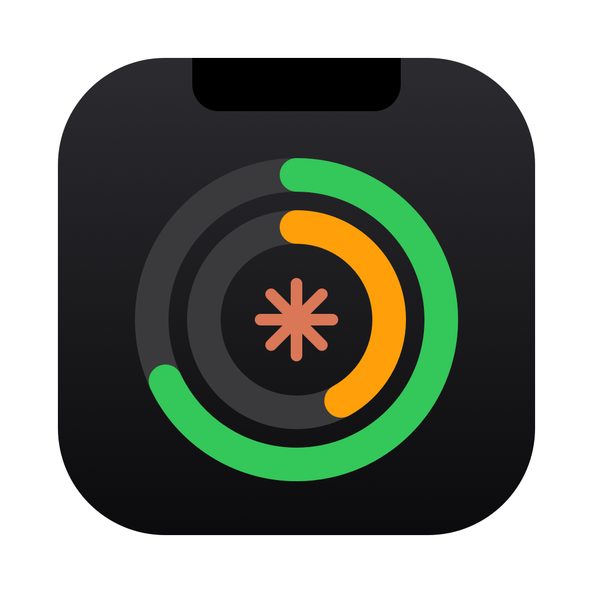
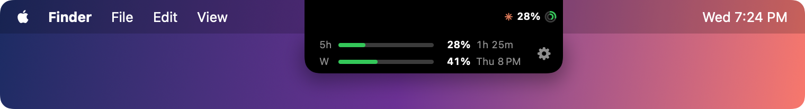
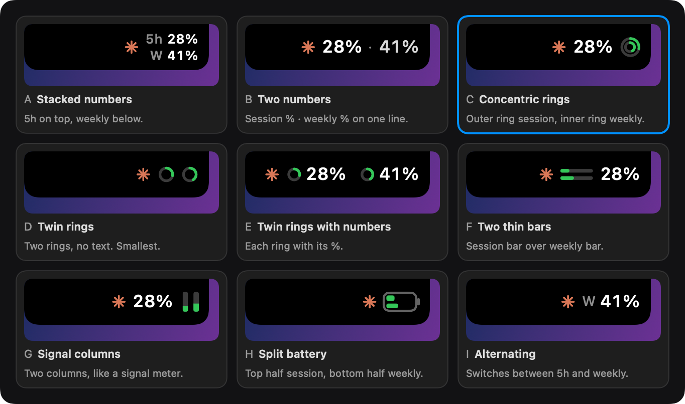

<p align="center">
  
</p>

<h1 align="center">AI Usage</h1>

<p align="center">Your Claude usage limits, right next to the MacBook notch.</p>

<p align="center">
  
</p>

AI Usage puts your Claude **5-hour session** and **weekly** usage beside the notch, so you can see how close you are to a limit without opening anything.

- **Always visible:** a small display on the right of the notch shows the 5-hour % and the weekly %.
- **Hover for details:** a box drops down under the notch with a bar, the % and the reset time for each limit.
- **9 styles:** pick the look you like in Settings.
- **Colour warnings:** green, then orange at 70%, then red at 90%.
- **No login:** it connects to Claude Code on your Mac. Nothing leaves your computer.
- **Works without a notch:** on other Macs and displays it shows as a small pill at the top centre of the screen.

<p align="center">
  
</p>

## Requirements

- macOS 14 (Sonoma) or later
- [Claude Code](https://code.claude.com), signed in with a Claude Pro or Max plan

## Install

### With Homebrew (recommended)

```sh
brew tap umairnawaz333/tap
brew install --cask ai-usage
```

Then open **AI Usage** from Applications or Spotlight.

### Manually

1. Download `AI-Usage.zip` from the [latest release](https://github.com/umairnawaz333/AIUsage/releases/latest).
2. Unzip it and drag **AI Usage.app** into **Applications**.
3. The app isn't notarized yet, so the first time, Control-click the app and choose **Open**, then click **Open** again. (Or go to **System Settings → Privacy & Security** and click **Open Anyway**.)

## Get started

1. Open **AI Usage**. Settings opens on first launch.
2. Under **Claude**, click **Connect**.
3. Send a message in Claude Code. Your usage appears beside the notch within a few seconds.

To open Settings later, hover over the notch and click the **gear**, right-click the notch, or open the app again.

## Styles

Choose one in **Settings → Notch style**. You can also hide the Claude icon to save space.

<p align="center">
  
</p>

## Update

```sh
brew upgrade --cask ai-usage
```

If you installed manually, download the latest release and replace the app in Applications. Your settings and connection are kept.

## Uninstall

**Remove everything (recommended).** This also restores your original Claude Code status line:

```sh
brew uninstall --zap --cask ai-usage
```

**Remove only the app:**

```sh
brew uninstall --cask ai-usage
```

This leaves the connection in place, so your Claude Code status line keeps working. To remove the connection too, click **Disconnect** in Settings before uninstalling, or run the `--zap` command above.

**If you installed manually:**

1. Open AI Usage → Settings → **Disconnect**.
2. Quit AI Usage (right-click the notch → **Quit AI Usage**).
3. Drag **AI Usage.app** from Applications to the Trash.
4. Optionally delete `~/Library/Application Support/AIUsage`.

If the app is already gone and you want to undo the connection by hand, open `~/.claude/settings.json` and set `statusLine` back to what it was. A copy of the file from just before AI Usage last changed it is saved as `~/.claude/settings.json.aiusage-backup`.

## How it works

Claude Code sends your usage limits to whatever program is set as its **status line**. When you click **Connect**, AI Usage points the status line at a small bridge script (`~/Library/Application Support/AIUsage/bridge.sh`). Each time Claude Code updates the status line, the bridge:

1. saves the usage numbers for AI Usage, then
2. runs your original status line command, if you had one, with the same input. Your status line looks exactly as before. If you didn't have one, nothing changes on screen.

Only the `statusLine` setting in `~/.claude/settings.json` changes, and **Disconnect** puts it back. Your own status line script is never edited.

The app checks for new numbers every 5 seconds. If several Claude Code sessions are open, it shows the highest value for the current window, because idle sessions report older numbers. When a limit resets, it shows 0% straight away.

## FAQ

**The numbers aren't updating.**
They update while Claude Code is running. Send a message in Claude Code, and check that Settings shows **Connected**.

**I use Claude on the web or the desktop app.**
That usage counts towards the same limits. It shows up here the next time Claude Code updates.

**My Mac doesn't have a notch.**
AI Usage shows as a small pill at the top centre of the screen. To preview that on a notched Mac, run `defaults write com.umairnawaz.AIUsage simulateNoNotch -bool YES` and relaunch. Run `defaults delete com.umairnawaz.AIUsage simulateNoNotch` to undo it.

**Does it send my data anywhere?**
No. Everything stays on your Mac.

## Build from source

Requires macOS 14+ and the Xcode command line tools.

```sh
scripts/build-app.sh          # builds "build/AI Usage.app"
open "build/AI Usage.app"
swift test                    # unit tests
scripts/make-dmg.sh           # builds "build/AI-Usage-<version>.dmg"
scripts/release.sh            # builds build/AI-Usage.zip and the Homebrew cask build/ai-usage.rb
swift scripts/make-icon.swift # redraws Resources/AppIcon.icns
"$(swift build --show-bin-path)/AIUsage" --render-readme-images docs   # redraws the README images
```

The version shown in Settings comes from the `VERSION` file, and the build number is the git commit count. The app is ad-hoc signed for now; removing the first-launch warning needs a Developer ID certificate and notarization.

`preview/index.html` and `preview/variants.html` are the HTML mockups used to choose the design.
